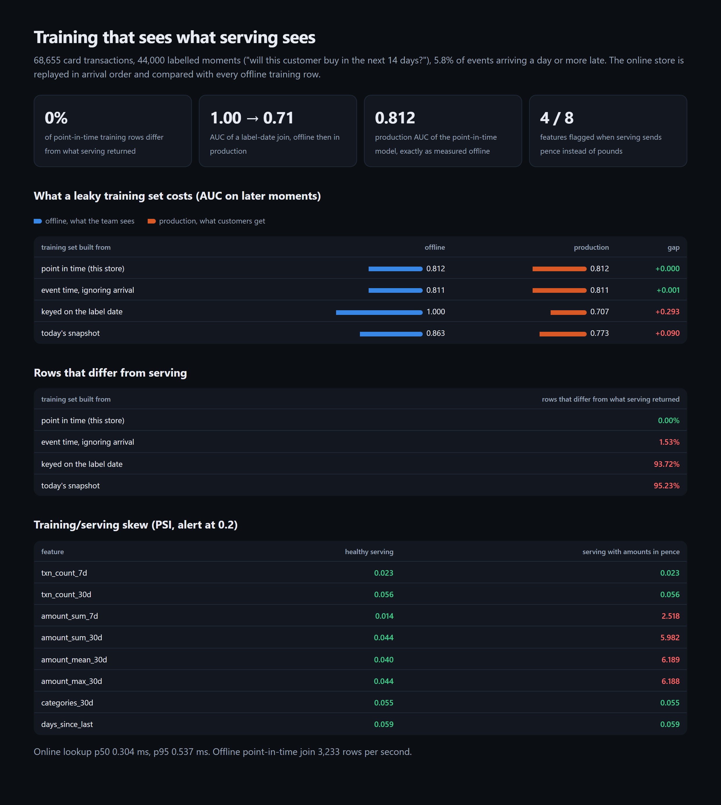

# Feature Store

A feature store that keeps training honest. Features are defined once and computed the same way
offline and online. Training sets are built *as known at* each prediction moment, so late data and
future data can't leak in. A skew check compares what serving produces with what training saw.
The leakage it prevents is measured: a leaky join can look perfect offline and still underperform
in production.

[](https://github.com/codeROCK-IZZY/feature-store/actions/workflows/ci.yml)



## Results

From `featurestore evaluate` (68,655 card transactions, 44,000 labelled moments of "will this
customer buy in the next 14 days?", 5.8% of events arriving a day or more late;
[full report](eval/reports/evaluation.md)):

| training set built from | rows that differ from serving | offline AUC | production AUC |
|---|---:|---:|---:|
| **point in time (this store)** | **0.00%** | **0.812** | **0.812** |
| event time, ignoring arrival | 1.53% | 0.811 | 0.811 |
| keyed on the label date | 93.72% | **1.000** | 0.707 |
| today's snapshot | 95.23% | 0.863 | 0.773 |

- **Training sees exactly what serving sees.** An independently written online store, replayed in
  arrival order, reproduces every one of the 44,000 offline training rows. Offline AUC equals
  production AUC.
- **The leaks look like wins.** Keying labels by the date the outcome was recorded lets feature
  windows cover the label period. That model scores a perfect 1.000 offline and 0.707 in
  production, worse than the honest model's 0.812. A snapshot join overstates AUC by 0.09.
- **Late data matters little here.** Ignoring arrival time changes 1.5% of rows and barely moves AUC
  in this data. The rule is still enforced, because it matters wherever late events carry the signal.
- **Skew is caught and localised.** When serving sends pence instead of pounds, PSI jumps from below
  0.06 to between 2.5 and 6.2 on all four amount features and stays flat on counts and recency.
- **Fast enough to serve:** online lookups take 0.30 ms at p50 and 0.54 ms at p95.

## How it works

- `features.py`: declarative feature views (count, sum, mean, max, distinct, days since; 7- and
  30-day windows). One `aggregate` function serves both stores. The registry refuses to change a
  definition in place: a change is a new version.
- `stores.py`:
  - the offline store, with four join modes, so the leaks can be measured rather than described;
  - an online store holding per-customer buffers, with events applied in arrival order and evicted
    after the longest window;
  - `replay`, which interleaves arrivals and requests as production would;
  - PSI.
- `evaluate.py`: consistency, offline against production AUC, and skew with and without a units bug
  ([ADR 1](docs/adr/0001-as-known-at-not-as-happened.md), [ADR 2](docs/adr/0002-skew-checks-on-serving.md)).

## Run it

```bash
python -m venv .venv && . .venv/bin/activate
pip install -e ".[dev]"
pytest
featurestore evaluate --gate          # ~1 min; writes eval/reports/{evaluation.md,evaluation.json,report.html}
featurestore lookup 7 --at 80         # one customer as of day 80: online, point in time, and the leaky joins
```

| check | where |
|---|---|
| 8 tests (a late event and a future event excluded, online equals offline, versioned registry, PSI), strict mypy, ruff | `tests/`, `src/` |
| the evaluation as a CI gate (zero mismatches, equal AUCs, leaks shown to inflate, skew caught without false alarms) | `.github/workflows/ci.yml` |

See [known limitations](docs/known-limitations.md).

## License

MIT
